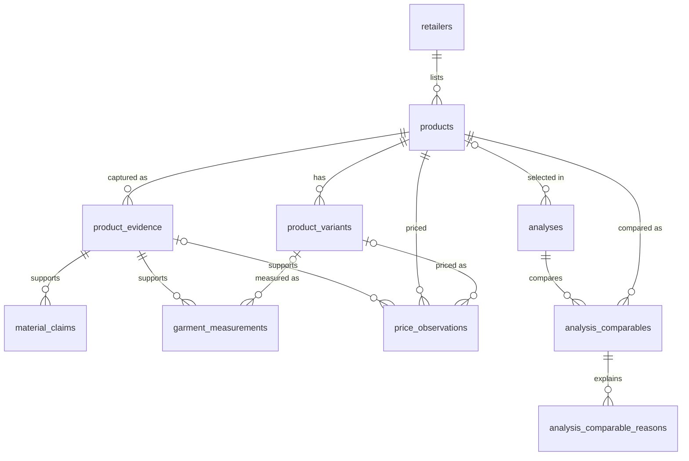

# Database

Supabase PostgreSQL schema for the fashion analysis backend.

| Path | Purpose |
|---|---|
| `supabase/migrations/20261017235500_initial_schema.sql` | Initial schema: tables, constraints, indexes, RLS, grants. |
| `supabase/checks/schema_checks.sql` | Constraint and access checks. Runs in one transaction and rolls back. |
| `supabase/config.toml` | Supabase CLI configuration from `supabase init`. Contains no credentials. |
| `web/.env.example` | Server-only environment variable names. Placeholders only. |

No product data is included. The JSON fixtures in `web/lib/contracts/fixtures/` are synthetic and are for development only. Do not load them into a real project.

## Tables

| Table | Primary key | Foreign keys | Notes |
|---|---|---|---|
| `retailers` | `id` | — | `domain` is unique and lowercase. |
| `products` | `id` | `retailer_id → retailers` | One row per retailer listing. `department` defaults to `unknown`. |
| `product_variants` | `id` | `product_id → products` | Color, size label, and description. Many per product. |
| `product_evidence` | `id` | `product_id → products` | Short excerpt (max 500 characters), source URL, source type, capture time, extractor version. Immutable. |
| `material_claims` | `id` | `(product_id, evidence_id) → product_evidence (product_id, id)` | One fiber per component per evidence row. `percent` may be null. |
| `price_observations` | `id` | `product_id → products`, `(product_id, variant_id) → product_variants`, `(product_id, evidence_id) → product_evidence` | Append-only. Integer minor units. |
| `garment_measurements` | `id` | `(product_id, evidence_id) → product_evidence`, `(product_id, variant_id) → product_variants` | Only listed measurements. Evidence is required. |
| `analyses` | `id` | `selected_product_id → products`, `(selected_product_id, selected_variant_id) → product_variants` | Extension submission plus lifecycle. |
| `analysis_comparables` | `(analysis_id, product_id)` | `analysis_id → analyses`, `product_id → products`, `(product_id, variant_id) → product_variants` | One row per alternative. |
| `analysis_comparable_reasons` | `id` | `(analysis_id, product_id) → analysis_comparables` | `kind` is `explanation`, `advantage`, `disadvantage`, or `uncertainty`, plus a `code` and `detail`. |



## Design decisions

**Evidence ownership is enforced with composite foreign keys.** `product_evidence` has `unique (product_id, id)`. Claims, measurements, and prices reference evidence as `(product_id, evidence_id)`, so a row for product A cannot cite evidence for product B. Variant references work the same way through `product_variants (product_id, id)`. This needs no triggers.

**Retailer-provided versus verified.** Every claim starts as `extracted`. `verified` requires `verified_at`, and the claim still points at its evidence row. The extension can never set this: the API stores its composition as `extracted`. Evidence `source_type` records where an excerpt came from: `extension_capture`, `manual_review`, or `retailer_feed`. A manual review is still retailer-provided text. It is not independent verification on its own.

**Fiber percentages.** `percent` is between 0 and 100, or null when the source gave no number. There is no rule that a product's claims total 100. Shell, lining, trim, and other stay separate through `component`.

**Prices are append-only.** Each observation is a new row with its own `observed_at`. Code should never update an existing price. `regular_amount_minor` is null unless the retailer listed a regular price, so a missing regular price never implies a discount. `listed_amount_minor` is required: if no price was shown, no row is written. Each row has one `currency` for both amounts.

**Measurements are never fabricated.** A measurement needs evidence, a positive value, a unit, and a `basis`. `basis` defaults to `unknown`. Missing measurements have no row. Size labels are retailer strings, and there is no size-conversion column.

**Analyses.**
- `processing_status`, `outcome`, `failure_*`, and `finished_at` must agree, with the same rules as the contract:
  - only `completed` has an outcome
  - only `failed` has a failure
  - `pending` has no `finished_at`
- `alternatives_found` and `no_suitable_alternative` require a selected product.
- `request_payload` keeps the validated extension request, up to 64 KB of JSON, so a pending analysis can be processed later.
- Raw page HTML is never stored.

**No ranking.** Comparables have no score, rank, or order column. Advantages and disadvantages are rows written by backend comparison code. Each is tied to listed facts, and the database doesn't compute any of them.

**Deletes.**
- Deleting a product cascades to its variants, evidence, claims, prices, and measurements.
- A product used by an analysis or comparable can't be deleted, so history stays intact.
- Deleting an analysis cascades to its comparables and reasons.

## Duplicate listings

- **Within one retailer:** a listing is unique by `(retailer_id, retailer_product_id)` when the retailer exposes an id, and always by `(retailer_id, canonical_url)`. Ingestion should strip tracking parameters and fragments from the URL before matching. It should look up an existing product by retailer id first, then by canonical URL.
- **Colors and sizes:** these are `product_variants` rows, not separate products. A variant is unique by `retailer_variant_id`, or by color, size, and description when there is no retailer id.
- **Repeat captures:** a new capture of the same page adds new evidence, claims, and price rows. It doesn't create a new product.
- **Same garment in two departments:** a garment listed separately in womens and mens, with its own URL or id, is two products on purpose. Those are exactly the listings we compare.
- **Across retailers:** listings are never merged. The same brand sold by two retailers is two products.

## Security

- RLS is enabled on every table, with no policies. A Supabase client using the publishable/anon key, or a signed-in user, gets no rows.
- The migration also revokes all table privileges from `anon` and `authenticated`. Clients can't insert, update, or delete even if a policy were added by mistake. The only function, `set_updated_at`, isn't executable by them.
- All reads and writes go through Next.js server code using the Supabase secret key. That key bypasses RLS.
- The browser and the Chrome extension never talk to Supabase directly. They only call our API routes.

Future server code needs two variables, listed in `web/.env.example`:

| Variable | Where to find it | Exposure |
|---|---|---|
| `SUPABASE_URL` | Project Settings → API | Server only |
| `SUPABASE_SECRET_KEY` | Project Settings → API Keys → secret key (`sb_secret_…`), or the legacy `service_role` key | Server only. Never prefix with `NEXT_PUBLIC_`. |

Put real values in `web/.env.local`, which `.gitignore` excludes. This repository is public, so never commit keys.

Any table added later needs the same treatment: enable RLS and revoke `anon` and `authenticated` access in its migration. Supabase grants those roles access to new public tables by default.

## Setup

The development project is `fashion-intelligence-dev`. Run these commands from the repository root. They were tested with CLI 2.121.0, and Docker is not required.

1. Log in in an interactive terminal (the browser flow needs a TTY). The access token is stored in the OS keychain, not in the repository.

   ```sh
   npx supabase@2.121.0 login
   ```

2. Link the project. The CLI reaches the database through a temporary login role, so no database password is needed. Link state goes in `supabase/.temp/`, which is git-ignored.

   ```sh
   npx supabase@2.121.0 link --project-ref <project-ref>
   ```

3. Check migration history, then push.

   ```sh
   npx supabase@2.121.0 migration list --linked
   npx supabase@2.121.0 db push --linked --dry-run
   npx supabase@2.121.0 db push --linked
   ```

4. Optional: run the checks. The output should end with `all schema checks passed`, and everything is rolled back.

   ```sh
   npx supabase@2.121.0 db query --linked -f supabase/checks/schema_checks.sql
   ```

5. Copy `web/.env.example` to `web/.env.local` and fill in the two values.

### Future migrations

- Create every schema change as a new file: `npx supabase@2.121.0 migration new <name>`. Never edit a migration that has already been pushed.
- Review the change with `db push --linked --dry-run`, then apply it with `db push --linked`.
- Don't paste tracked migrations into the SQL Editor. SQL Editor changes skip the migration history table, so the next `db push` gets out of sync with the database.
- Use the SQL Editor only for read-only queries or for scripts that roll back, such as `checks/schema_checks.sql`.
- Never run `supabase db reset --linked` against a shared project. It drops all data.
- New tables need RLS enabled and `anon`/`authenticated` privileges revoked in the same migration.

## Validation status

### Supabase (2026-10-17)

Run on project `fashion-intelligence-dev`, PostgreSQL 17.11 (Supabase image 17.11.0.003), with CLI 2.121.0.

- **Before the push:** `public` had no tables or functions, and there was no migration history. The dry run listed only `20261017235500_initial_schema.sql`, with no seeds, roles, or vault changes.
- **Push:** `db push --linked` applied the migration without errors. `migration list` shows `20261017235500` both locally and remotely, and `supabase_migrations.schema_migrations` has one row, `20261017235500 initial_schema`.
- **`schema_checks.sql`:** run with `db query --linked`. It returned `all schema checks passed`. The checks cover:
  - Defaults and duplicate products.
  - Ownership of evidence and variants (claims, prices, and measurements citing another product's rows were rejected).
  - Fiber percentages and components.
  - Price sign, currency, and append-only history.
  - Measurements.
  - The analysis lifecycle.
  - Comparables and reasons.
  - Delete protection and cascades.
  - `anon` access denied, RLS hiding rows even with a mistaken grant, and `service_role` read/write.
- **Cleanup:** afterwards, all 10 tables had 0 rows, and `anon` had no table privileges, so the temporary grant was rolled back too.
- **Catalog checks:**
  - All 10 tables exist, each with a primary key.
  - The 8 two-column ownership foreign keys are present.
  - RLS is enabled on every table, and there are no policies.
- **Privileges:**
  - `anon` and `authenticated` have no `select`, `insert`, `update`, or `delete` privilege on any table, and can't execute `set_updated_at()`.
  - `service_role` has all four privileges on all 10 tables and has `bypassrls`.
- **Role checks** (one-off script, rolled back):
  - As `authenticated`, select, insert, update, and delete all failed with `insufficient_privilege`. As `anon`, update and delete failed the same way.
  - As `service_role`, inserting a retailer, product, evidence, claim, and price worked. The `updated_at` trigger ran, and deleting the product cascaded.
  - No rows were left afterwards.

### PGlite (2026-10-17, before deployment)

The same migration and checks passed on PGlite 0.5.10 (PostgreSQL 18.6 in WebAssembly). The Supabase roles and default grants were recreated by hand for that run.

### Differences between PGlite and Supabase

No behavior differences: the migration and every check passed unchanged on both. The differences are in the environment only:
- The PostgreSQL version: 18.6 on PGlite, 17.11 on Supabase.
- PGlite needed the Supabase roles and default privileges recreated by hand. On Supabase they are built in, and the migration's revokes overrode Supabase's default grants to `anon` and `authenticated`.

### Not yet tested

- Requests through the HTTP Data API (PostgREST) using the publishable and secret keys. Only the database-role checks above have run.
- Query performance at realistic data sizes.

## Mapping to contract 3.0.0

The API builds the Zod responses from these tables. The tables are not a one-to-one copy of the response.

| Contract field | Source |
|---|---|
| `analysisId`, `processingStatus`, `outcome`, `submittedPageUrl` | `analyses` |
| `failure` | `analyses.failure_code`, `failure_message` |
| `product.id`, `title`, `brand`, `pageUrl`, `imageUrl`, `retailerProductId`, `department`, `category` | `products` (`pageUrl` = `canonical_url`) |
| `product.variantLabel` | Selected variant's `color`, falling back to `description` |
| `price.listed`, `price.regular`, `price.observedAt` | Latest `price_observations` row for the product (or the selected variant) at or before `analyses.finished_at` |
| `composition[]` | `material_claims` (`fiber`, `percent`, `component`, `raw_text`, `verification_status`) |
| `evidence[]` | `product_evidence` rows cited by those claims (`productId` = `product_id`) |
| `fit.measurements[]` | `garment_measurements` (`name`, `value`, `unit`, `size_label`, `basis`). `availability` is derived from whether rows exist. |
| `alternatives[]` | `analysis_comparables`, using the same product, price, claim, and measurement sources |
| `alternatives[].explanations`, `advantages`, `disadvantages`, `uncertainties` | `analysis_comparable_reasons` grouped by `kind` |
| `alternatives[].priceDifference` | Computed by the API from the two price rows. Only when currencies match. Not stored. |
| `warnings[]` | Computed by the API from missing data. Not stored. |

Evidence and prices are append-only, so "latest at or before `finished_at`" gives the same answer when an analysis is read again later. Before returning a response, the API parses it with `FullAnalysisResponseSchema`. That catches anything the database can't enforce across tables: matching an alternative count to the outcome, and price-advantage signs.

## Data strategy

- **Seed catalog:** add retailers (Abercrombie & Fitch, H&M, and Uniqlo as a neutral comparison) and a small set of sweaters and knitwear reviewed by hand. Store each product's page text as `manual_review` evidence. Use only real listings with their real URLs, never invented garments.
- **Extension captures:** each capture writes `extension_capture` evidence with the extractor version, plus new claim and price rows.
- **Retailer feeds:** approved feeds write `retailer_feed` evidence. Use the feed's retailer ids to match existing products.
- **Repeated prices:** every capture or feed run appends a price observation. History is never overwritten.
- **Cross-department matching:** filter candidates by normalized `category`, department, and fiber, with an index on `(category, department)`. Ingestion should normalize `category` to a short shared value such as `sweater`, so listings can be compared across departments and retailers.
